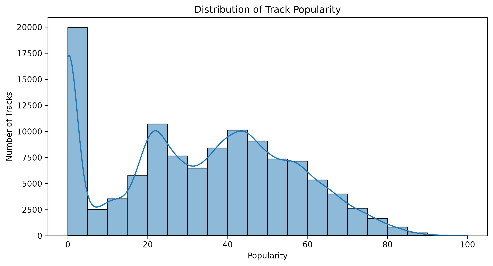
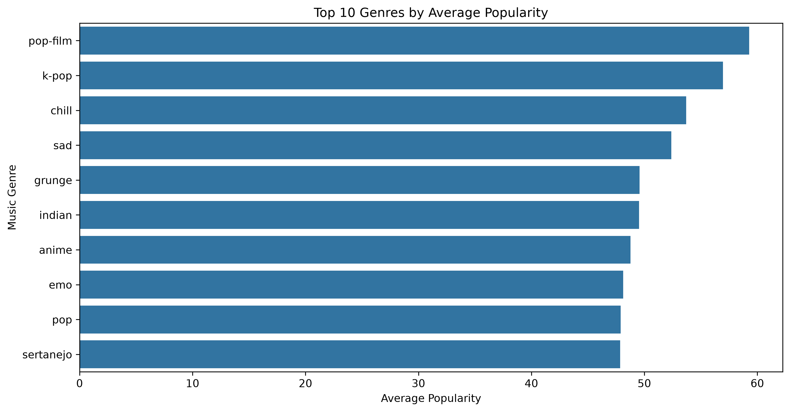
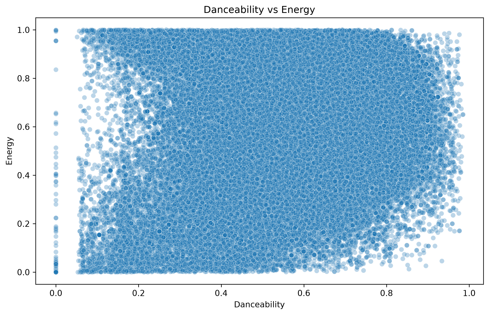
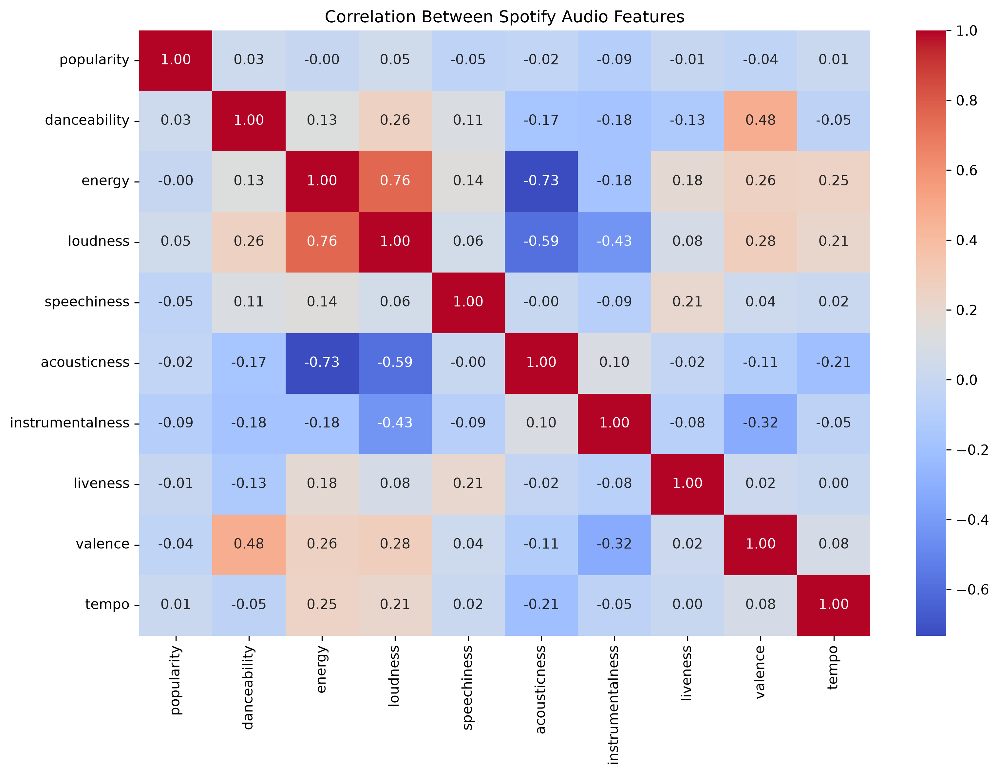
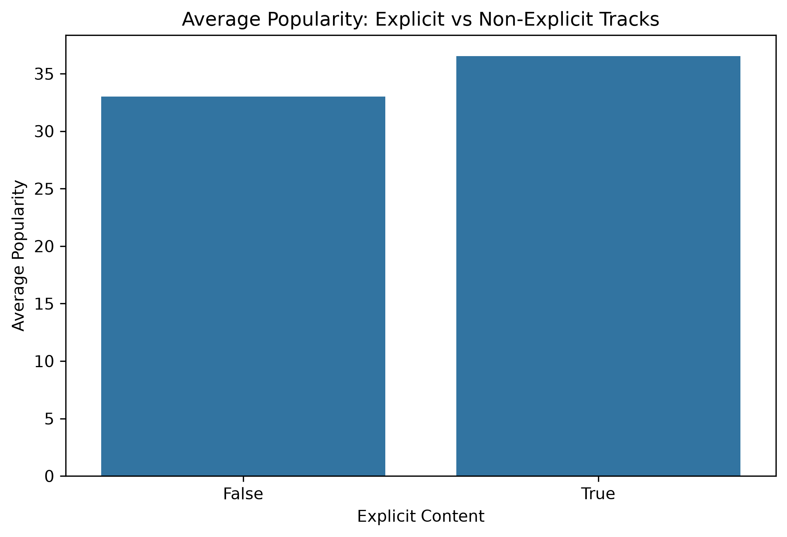

# Spotify Music Dataset – Exploratory Data Analysis (EDA)

## Project Overview
This project explores the Spotify Tracks Dataset using Python. The goal is to analyze music trends, track popularity, genres, and audio features through data cleaning, statistical analysis, and visualization.

## Dataset
- Original records: 114,000
- Records after cleaning: 113,549
- Features: 20 columns
- Missing values after cleaning: 0

## Tools & Technologies
- Python
- Pandas
- NumPy
- Matplotlib
- Seaborn
- VS Code

## Data Cleaning
- Checked missing values and duplicate records.
- Removed 450 exact duplicate rows.
- Removed one row containing missing values.
- Converted track duration from milliseconds to minutes.
- Investigated repeated track IDs and retained valid entries across different genres.

## Analysis & Visualizations

### 1. Distribution of Track Popularity


### 2. Top 10 Genres by Average Popularity


### 3. Danceability vs Energy


### 4. Correlation Between Spotify Audio Features


### 5. Average Popularity: Explicit vs Non-Explicit


## Key Findings
- The average track popularity is 33.32.
- Pop-film has the highest average popularity (59.28), followed by K-pop (56.96).
- The average track duration is approximately 3.8 minutes.
- A total of 151 tracks are longer than 15 minutes.
- Energy and loudness have a strong positive correlation (0.76).
- Individual audio features have very weak linear correlations with popularity.
- Explicit tracks have a higher average popularity (36.52) than non-explicit tracks (33.02).

## Project Structure
```text
spotify_EDA/
│
├── dataset/
├── visualizations/
├── analysis.py
└── README.md
```

## Conclusion
This analysis explores patterns in Spotify tracks, including popularity, genre differences, track duration, and audio features. It also highlights relationships between musical characteristics and popularity.

The project demonstrates practical skills in data cleaning, exploratory data analysis, statistical analysis, and data visualization using Python.